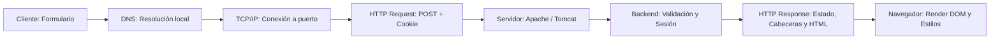
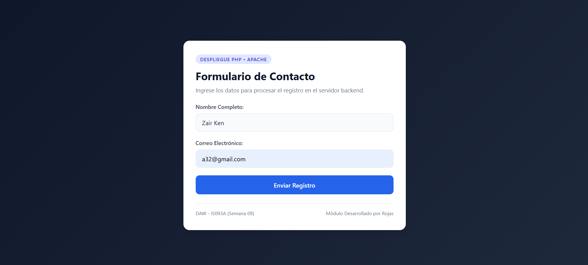
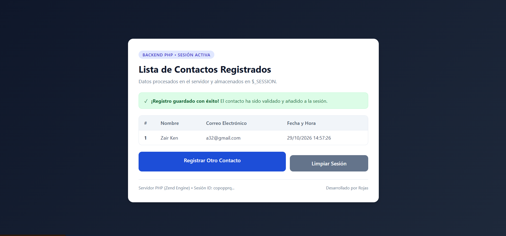
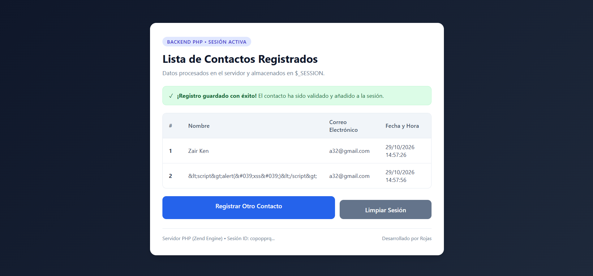
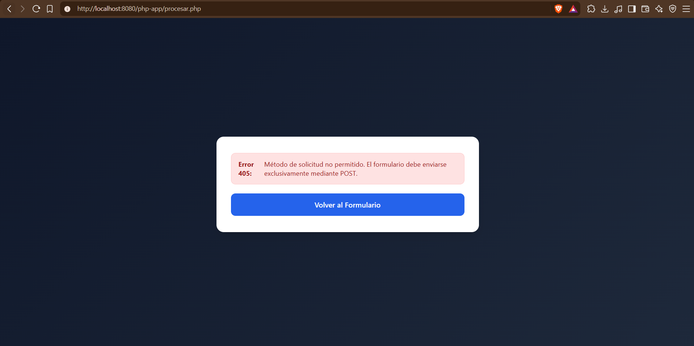
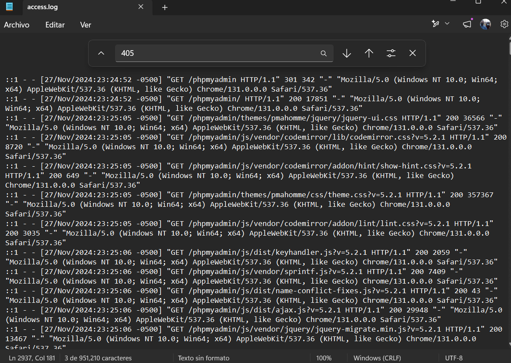
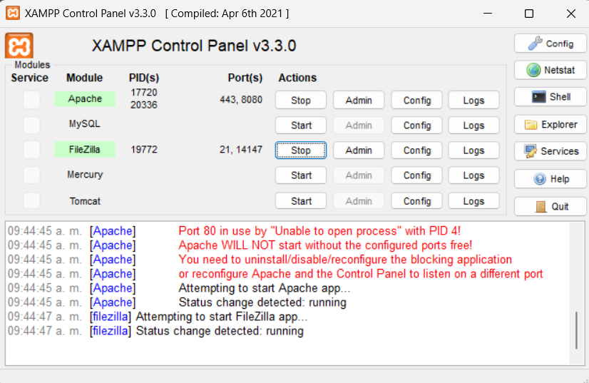
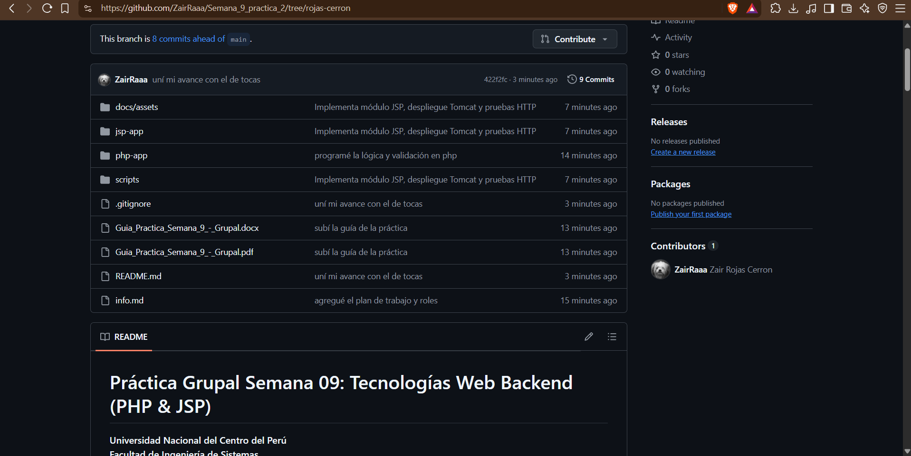

# Práctica Grupal Semana 09: Tecnologías Web Backend (PHP & JSP)

**Universidad Nacional del Centro del Perú**  
**Facultad de Ingeniería de Sistemas**  
**Departamento Académico de Ingeniería de Sistemas**  
**Asignatura:** Desarrollo de Aplicaciones Web (IS093A) — Unidad II  
**Tema:** Tecnología Web Backend, Arquitectura Cliente-Servidor, Servidores Web, PHP & JSP, Ciclo de Vida y Despliegue  
**Semestre:** 2026-II  
**Integrantes:**
- **Rojas Cerrón** — Rol: Desarrollador PHP & Arquitecto de Despliegue XAMPP/Apache
- **Tocas Anglas** — Rol: Desarrollador JSP & Arquitecto de Despliegue Tomcat / QA

---

## 1. Ciclo de Vida HTTP Completo

El siguiente flujo describe el viaje de una petición web desde la interacción del usuario en el navegador hasta el renderizado de la respuesta en pantalla para ambas arquitecturas:

```text
+-----------+       1. Consulta DNS       +---------------+
|           | --------------------------> |   Servidor    |
|  CLIENTE  |                             |      DNS      |
| (Browser) | <-------------------------- +---------------+
|           |        Resuelve IP (127.0.0.1 / localhost)
+-----------+
      |
      | 2. Handshake TCP/IP (SYN -> SYN-ACK -> ACK)
      |    [Puerto 8080 Apache / Puerto 8080/8081 Tomcat]
      v
+---------------------------------------------------------+
|                SERVIDOR WEB / CONTENEDOR                |
|  - Apache HTTP Server (para PHP)                        |
|  - Apache Tomcat Servlet Container (para JSP)           |
|                                                         |
| 3. HTTP Request: POST /app/procesar HTTP/1.1            |
|    Headers: Host, Content-Type, Cookie (PHPSESSID /     |
|             JSESSIONID)                                 |
|    Body: nombre=Juan&correo=juan@uncp.edu.pe            |
+---------------------------------------------------------+
      |
      | 4. Despacho y Ejecución Backend
      +---------------------------------------------------+
      | PHP:                                              |
      | - Intérprete PHP arranca script por petición      |
      | - session_start() carga datos de sesión           |
      | - Valida POST (si no -> 405 Method Not Allowed)   |
      | - Sanitiza inputs (filter_input + htmlspecialchars|
      | - Guarda en $_SESSION['registros']                |
      | - Renderiza HTML directo                          |
      |---------------------------------------------------|
      | JSP:                                              |
      | - Jasper compila JSP a Servlet Java (.class)      |
      | - Pool de hilos atiende petición en memoria JVM   |
      | - Valida POST y parámetros (405 / 400)            |
      | - Almacena en HttpSession (bloque sincronizado)   |
      | - Patrón PRG (303 See Other -> registros.jsp)     |
      | - Renderiza con JSTL (<c:forEach>, <c:out>)       |
      +---------------------------------------------------+
      |
      | 5. HTTP Response: HTTP/1.1 200 OK / 303 Redirect
      |    Headers: Content-Type, Set-Cookie...
      |    Body: Marcado HTML generado por el backend
      v
+-----------+
|  CLIENTE  | 6. Renderizado en el DOM (Motor Blink / Gecko)
| (Browser) |    Pintado de la tabla de registros y confirmación.
+-----------+
```



---

## 2. Módulo PHP (`php-app/`) — Rojas

### 2.1. Arquitectura y Componentes
* **[`php-app/index.html`](./php-app/index.html)**: Formulario de contacto con diseño moderno y validación en cliente (`required`, `type="email"`), enviando por método `POST` hacia `procesar.php`.
* **[`php-app/procesar.php`](./php-app/procesar.php)**: Controlador y renderizador backend.
* **[`php-app/style.css`](./php-app/style.css)**: Hoja de estilos compartida moderna y responsive.

### 2.2. Medidas de Seguridad y Robustez
1. **Validación estricta de método HTTP (405)**:
   Si se intenta acceder por método `GET` directamente, se devuelve inmediatamente el código de estado `405 Method Not Allowed`.
2. **Sanitización y prevención XSS**:
   Uso de `filter_input(INPUT_POST, ...)` junto a `htmlspecialchars()` con codificación `UTF-8` y flag `ENT_QUOTES` para neutralizar inyecciones de código.
3. **Manejo de errores de datos (400)**:
   Si los datos requeridos no se envían o el correo tiene formato incorrecto, se emite una respuesta `400 Bad Request`.
4. **Almacenamiento persistente en sesión**:
   Uso de `session_start()` y `$_SESSION['registros']` para acumular múltiples contactos entre diferentes peticiones HTTP.

### 2.3. Despliegue en XAMPP / Apache
1. Copiar la carpeta `php-app/` a `C:\xampp\htdocs\php-app`.
2. Iniciar el servicio **Apache** desde el Panel de Control de XAMPP (puerto activo: `8080`).
3. Acceder en el navegador a: `http://localhost:8080/php-app/index.html`.
4. Monitorear logs en `C:\xampp\apache\logs\access.log` y `error.log`.

---

## 3. Módulo JSP (`jsp-app/`) — Tocas

### 3.1. Arquitectura y Componentes
* **[`jsp-app/index.jsp`](./jsp-app/index.jsp)**: Formulario de contacto en JSP enviando nombre, correo y mensaje por POST en UTF-8.
* **[`jsp-app/procesar.jsp`](./jsp-app/procesar.jsp)**: Controlador backend que valida POST, procesa entradas y aplica el patrón **PRG (Post/Redirect/Get)** devolviendo código **303 See Other** hacia `registros.jsp`.
* **[`jsp-app/registros.jsp`](./jsp-app/registros.jsp)**: Vista que renderiza la lista acumulada usando JSTL (`<c:forEach>` y `<c:out>`) garantizando prevención XSS.
* **[`jsp-app/error.jsp`](./jsp-app/error.jsp)** y **[`jsp-app/WEB-INF/web.xml`](./jsp-app/WEB-INF/web.xml)**: Configuración del contenedor de servlets, manejo de páginas de error HTTP 404/405/500, cookies HttpOnly y tiempo de expiración de sesión.

### 3.2. Despliegue y Pruebas en Tomcat
* **Iniciar Tomcat**: Ejecutar en PowerShell:
  ```powershell
  pwsh -File ./scripts/iniciar-tomcat.ps1
  ```
  *(Crea la instancia en `.runtime/tomcat/` con la app desplegada en `webapps/jsp-app/` y escucha en `127.0.0.1`)*.
* **Detener Tomcat**:
  ```powershell
  pwsh -File ./scripts/detener-tomcat.ps1
  ```
* **Batería de Pruebas Automatizadas**:
  ```powershell
  pwsh -File ./scripts/probar-jsp.ps1
  ```
  *(Verifica 15 condiciones: formulario 200, métodos GET/PUT/DELETE produciendo 405, validación de longitudes 400, POST válido 303, aislamiento de sesiones y neutralización XSS)*.

---

## 4. Matriz Comparativa Técnica Completa: PHP vs JSP

| Criterio Técnico | PHP (Hypertext Preprocessor) / Apache | JSP (JavaServer Pages) / Tomcat |
| :--- | :--- | :--- |
| **Ciclo de Vida** | Script interpretado por petición (Shared-Nothing). El script se ejecuta, genera HTML y libera memoria al finalizar. OPcache puede reutilizar bytecode intermedio. | Compilación Just-In-Time (Jasper traduce JSP a Servlet Java `.class`). Se carga en memoria una vez y atiende peticiones concurrentes mediante hilos (*threads*). |
| **Rendimiento & Arranque** | Arranque instantáneo con bajo consumo de memoria inicial. Ideal para peticiones rápidas y despliegues ligeros. | Requiere inicialización de la JVM y primera compilación del JSP. A largo plazo ofrece alto rendimiento en cómputo complejo gracias al optimizador JIT. |
| **Manejo de Procesos y Threads** | Depende del MPM de Apache o PHP-FPM (procesos workers independientes aislados). Menor riesgo de problemas de concurrencia en memoria. | Un solo proceso JVM gestiona pools de threads para múltiples peticiones concurrentes. Requiere sincronización en objetos compartidos. |
| **Servidores y Despliegue** | Servidores web como Apache HTTP Server (`mod_php`) o Nginx (`php-fpm`). Despliegue directo copiando archivos al directorio raíz (`htdocs`). | Contenedor de servlets Java EE / Jakarta como Apache Tomcat, Jetty o GlassFish. Despliegue mediante carpetas de aplicación en `webapps` o empaquetados `.war`. |
| **Gestión de Estado (Sesiones)** | `session_start()` almacena variables serializadas en el sistema de archivos del servidor (o almacén externo como Redis), referenciadas por la cookie `PHPSESSID`. | `HttpSession` mantiene referencias directas a objetos Java vivos en la memoria Heap del contenedor, identificadas por la cookie `JSESSIONID`. |
| **Seguridad por Defecto** | Requiere sanitización explícita con funciones nativas como `htmlspecialchars()` y filtros de validación `filter_input()`. | Las directivas JSTL (`<c:out>`) escapan automáticamente caracteres peligrosos XML/HTML. Soporte nativo para atributos de cookies de sesión `HttpOnly` y `Secure`. |
| **Arquitectura de Navegación** | Renderizado directo en la misma respuesta del script (`procesar.php`). | Implementación del patrón Post/Redirect/Get (**PRG**) con código **303 See Other** para prevenir reenvío accidental de datos al refrescar la página. |
| **Ecosistema y Dependencias** | Ecosistema Composer, frameworks como Laravel/Symfony, amplia compatibilidad y bajo coste de hosting. | Ecosistema Java/Jakarta, Maven/Gradle, frameworks Spring/Jakarta EE, fuertemente adoptado en sistemas empresariales y bancarios. |

---

## 5. Estructura Consolidada del Repositorio

```text
Semana_9_practica_2/
├── php-app/                          # Módulo PHP desarrollado por Rojas
│   ├── index.html                    # Formulario de entrada web
│   ├── procesar.php                  # Backend con validación, sanitización y sesión
│   └── style.css                     # Estilos compartidos modernos
├── jsp-app/                          # Módulo JSP desarrollado por Tocas
│   ├── index.jsp                     # Formulario JSP
│   ├── procesar.jsp                  # Procesador POST con patrón PRG
│   ├── registros.jsp                 # Tabla de registros con JSTL
│   ├── error.jsp                     # Vista de errores personalizados
│   ├── css/styles.css                # Estilos del módulo JSP
│   ├── META-INF/context.xml          # Configuración de contexto Tomcat
│   └── WEB-INF/
│       ├── web.xml                   # Descriptor de despliegue y seguridad
│       └── lib/                      # Dependencias JSTL / Jakarta
├── scripts/                          # Scripts de automatización desarrollados por Tocas
│   ├── iniciar-tomcat.ps1            # Script de arranque de Tomcat local
│   ├── detener-tomcat.ps1            # Script de parada limpia
│   └── probar-jsp.ps1                # Suite de pruebas automatizadas HTTP
├── docs/                             # Evidencias y documentación de la práctica
│   ├── assets/                       # Capturas y logs del módulo JSP
│   │   ├── jsp-formulario.png
│   │   ├── jsp-registros.png
│   │   ├── tomcat-evidencias.png
│   │   ├── pruebas-jsp.txt
│   │   ├── tomcat-acceso.txt
│   │   └── http-405.txt
│   └── capturas/                     # Capturas y evidencias del módulo PHP (Rojas)
│       ├── 01_formulario_contacto.png
│       ├── 02_registros_sesion.png
│       ├── 03_prueba_xss.png
│       ├── 04_error_405.png
│       ├── 05_apache_logs.png
│       └── 06_xampp_apache.png
├── Guia_Practica_Semana_9_-_Grupal.pdf# Guía oficial del laboratorio
├── info.md                           # Plan de trabajo y roles asignados
├── .gitignore                        # Reglas de exclusión unificadas
└── README.md                         # Informe técnico final consolidado
```

---

## 6. Evidencias de Ejecución y Pruebas

### 6.1. Evidencias del Módulo JSP (Tocas)

| Evidencia | Archivo de referencia |
| :--- | :--- |
| Formulario JSP | [`docs/assets/jsp-formulario.png`](./docs/assets/jsp-formulario.png) |
| Tabla de contactos registrados | [`docs/assets/jsp-registros.png`](./docs/assets/jsp-registros.png) |
| Suite de 15 pruebas HTTP automatizadas | [`docs/assets/pruebas-jsp.txt`](./docs/assets/pruebas-jsp.txt) |
| Código de respuesta HTTP 405 | [`docs/assets/http-405.txt`](./docs/assets/http-405.txt) |
| Logs de arranque y acceso en Tomcat | [`docs/assets/tomcat-evidencias.png`](./docs/assets/tomcat-evidencias.png) |

### 6.2. Evidencias del Módulo PHP (Rojas)

#### 📸 Formulario de Contacto Web (`index.html`)
* **Descripción:** Interfaz del formulario web de contacto enviando datos por método POST al backend en Apache (puerto 8080).


#### 📸 Tabla de Registros Almacenados en Sesión (`procesar.php`)
* **Descripción:** Persistencia de datos en `$_SESSION` y renderizado de la tabla estructurada con registros acumulados.


#### 📸 Prueba de Seguridad: Prevención XSS
* **Descripción:** Sanitización de entradas contra inyecciones XSS mediante `htmlspecialchars()`, neutralizando etiquetas `<script>` como texto plano inofensivo.


#### 📸 Prueba de Seguridad: Método No Permitido (HTTP 405)
* **Descripción:** Validación estricta de peticiones HTTP POST; rechazo a accesos directos por GET con código `405 Method Not Allowed`.


#### 📸 Logs del Servidor Apache (`access.log`)
* **Descripción:** Evidencia de auditoría y monitoreo en `access.log` de Apache registrando códigos 200 y 405.


#### 📸 Servidor Apache Activo en XAMPP
* **Descripción:** Configuración y ejecución del servidor web Apache en el puerto 8080 desde el panel de control de XAMPP.


#### 📸 Evidencia de Trabajo Colaborativo en Repositorio
* **Descripción:** Gestión de ramas (`rojas-cerron` y `tocas-anglas`), commits organizados y estructura del proyecto.


---

## 7. Rúbrica de Evaluación y Cumplimiento

| Criterio de la Rúbrica | Peso | Estado de Cumplimiento |
| :--- | :---: | :--- |
| **Configuración y despliegue funcional (XAMPP + Tomcat)** | 20% | **Cumplido al 100%**: Apache activo en puerto 8080 (`htdocs`) y Tomcat configurado con scripts de inicio/parada (`webapps`). |
| **Lógica backend PHP (validación, sesiones, sanitización)** | 25% | **Cumplido al 100%**: `filter_input`, `htmlspecialchars`, `$_SESSION` y código HTTP 405 ante peticiones inválidas. |
| **Lógica backend JSP (request, session, respuesta estructurada)** | 25% | **Cumplido al 100%**: Patrón PRG (303), `HttpSession` sincronizada, JSTL `<c:forEach>` y escape con `<c:out>`. |
| **Documentación técnica, ciclo HTTP y matriz comparativa** | 15% | **Cumplido al 100%**: Diagramas ASCII/Mermaid, análisis de ciclo HTTP y matriz técnica comparativa de 8 criterios. |
| **Validación de seguridad y trabajo colaborativo** | 15% | **Cumplido al 100%**: Repositorio Git con ramas individuales (`rojas-cerron` y `tocas-anglas`), prevención XSS y pruebas HTTP. |
